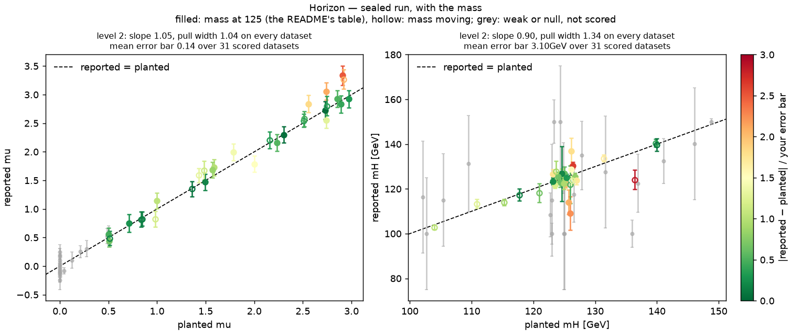
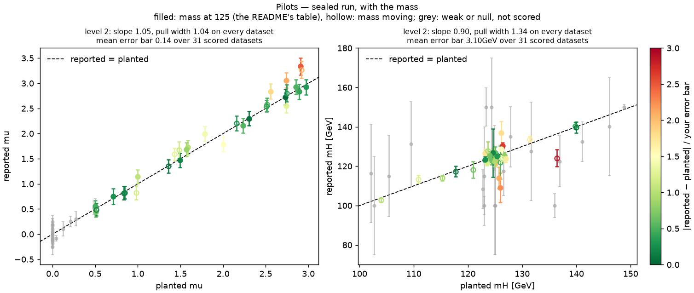
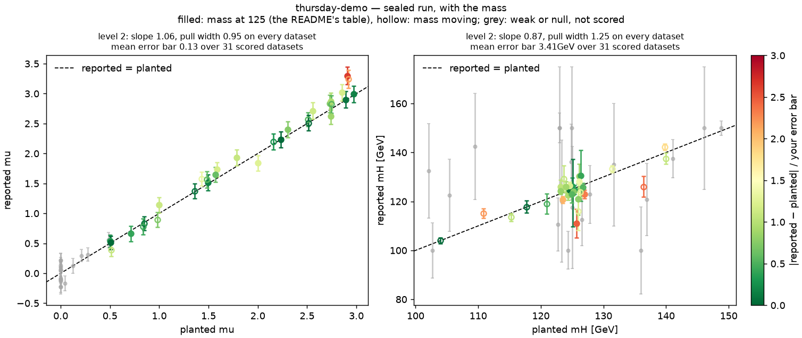
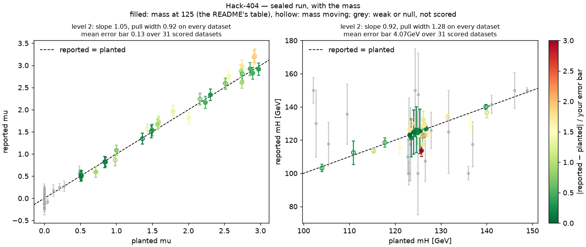
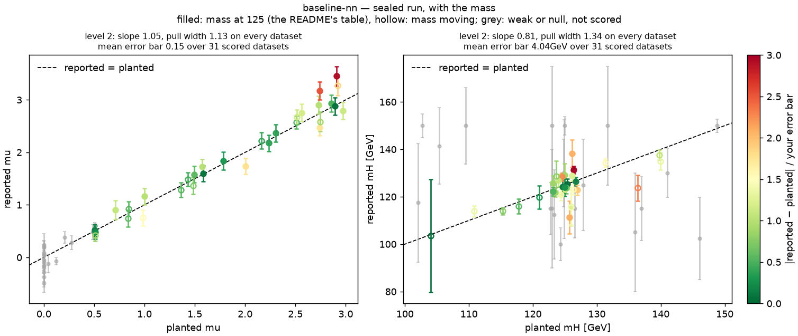

# Leaderboard, with the mass

The [README](README.md)'s table scores μ alone, on the sealed datasets whose Higgs mass stays at 125 GeV. This
page scores μ and the mass, each by the same rule, on every sealed dataset, where the mass moves between 100 and
150 GeV and the two have to be measured together. The mass (`mH` in RESULT.json) is optional: it counts here when
it is reported on every dataset, and it never costs anything in the README's table.

<!-- leaderboard -->
_Sealed run of 2026-10-15 08:23 UTC: μ and the mass on all 51 sealed datasets, the mass moving between 100 and 150 GeV; the main table, μ on the 26 fixed-mass datasets, is in the [README](README.md). Each team's plot on every dataset is folded at the bottom. A submission gets at most 60 minutes per run; the datasets left when they run out count as not run._

| # | team          | score | error μ | error mass | slope μ | pull width μ | slope mass | pull width mass | submitted                                         |
|---|---------------|-------|---------|------------|---------|--------------|------------|-----------------|---------------------------------------------------|
| 1 | Horizon       | –     | –       | –          | 1.05    | 1.04         | 0.90       | 1.34            | d8bc180 (2026-10-15T04:50:58Z by AnushSingla)     |
| 2 | Pilots        | –     | –       | –          | 1.05    | 1.04         | 0.90       | 1.34            | 3be629b (2026-10-15T06:57:34Z by ishandhull2953)  |
| 3 | baseline-mt   | –     | –       | –          | 1.05    | 1.04         | 0.90       | 1.34            | 52ad132 (2026-10-14T08:25:55Z by andrzejnovak)    |
| 4 | team_x        | –     | –       | –          | 1.05    | 1.04         | 0.90       | 1.34            | 4bc4ba0 (2026-10-15T07:12:25Z by gauriaggarwal31) |
| 5 | thursday-demo | –     | –       | –          | 1.06    | 0.95         | 0.87       | 1.25            | a71c823 (2026-10-15T04:53:09Z by andrzejnovak)    |
| 6 | Hack-404      | –     | –       | –          | 1.05    | 0.92         | 0.92       | 1.28            | 0909838 (2026-10-15T07:18:42Z by shaurya-cd)      |
| 7 | baseline-nn   | –     | –       | –          | 1.05    | 1.13         | 0.81       | 1.34            | c549c28 (2026-10-14T08:26:00Z by andrzejnovak)    |

<b>Recovery plots</b>, per team: μ and the mass, reported against planted on every sealed dataset, filled points the fixed-mass datasets, hollow the moving ones

**Horizon** (score –)

**Pilots** (score –)

**baseline-mt** (score –)

**team_x** (score –)

**thursday-demo** (score –)

**Hack-404** (score –)

**baseline-nn** (score –)

<!-- /leaderboard -->

### Reading the table

- **score**, the order: as in the README, 100 × the template fit's calibrated error over yours, here averaged
  over μ and the mass where you report it (μ alone where you don't), both on every dataset. The template fit
  scores 100.
- **error μ**, **error mass**: your calibrated error bars, the mean error bar you quote times the pull width
  where that is above 1, on every dataset.
- **slope**, **pull width**, **submitted**: as in the README; the μ columns over every dataset, the mass columns
  over every dataset where the mass is reported.
- In the plots, filled points are the fixed-mass datasets the README scores and hollow ones the moving-mass
  datasets; the colour is the pull, as in the README. Your own: `python3 score_suite.py <submission> <suite> --plot recovery.png`.
