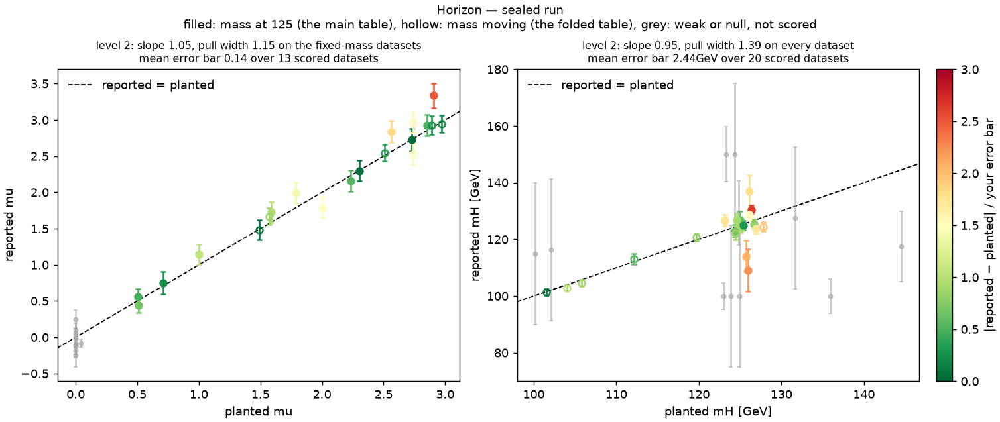
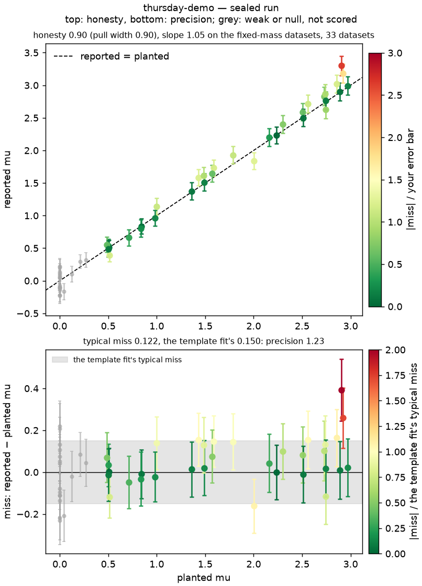
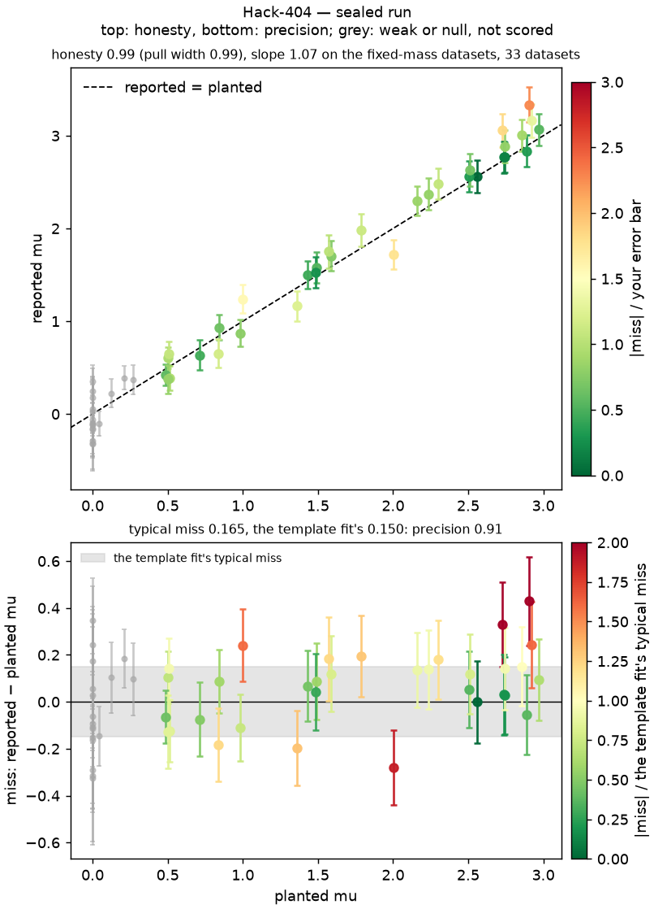
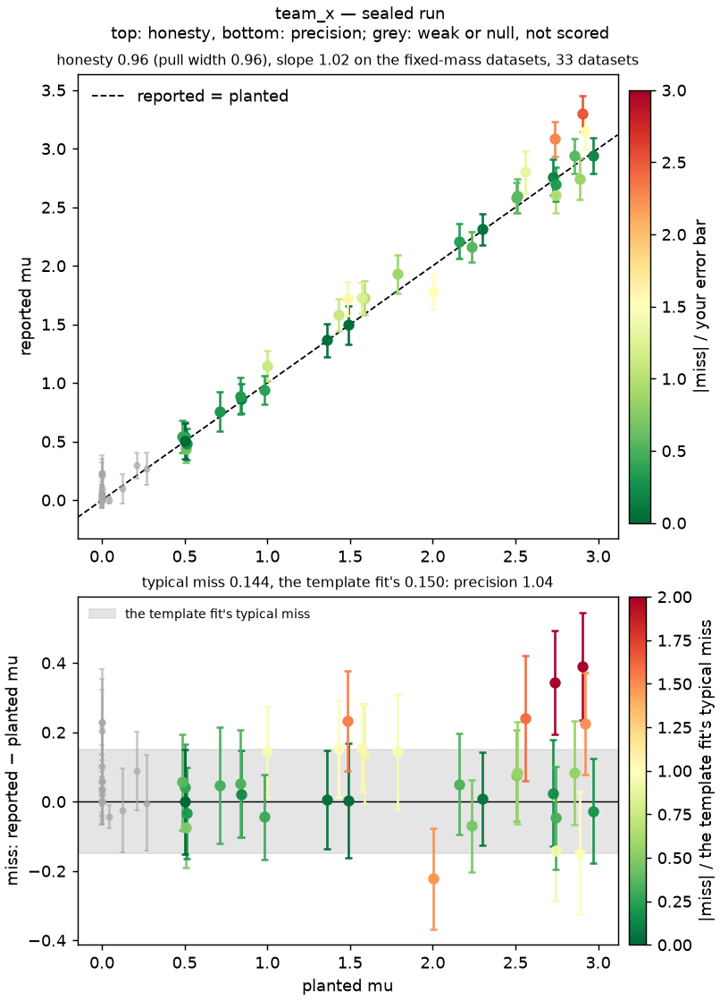
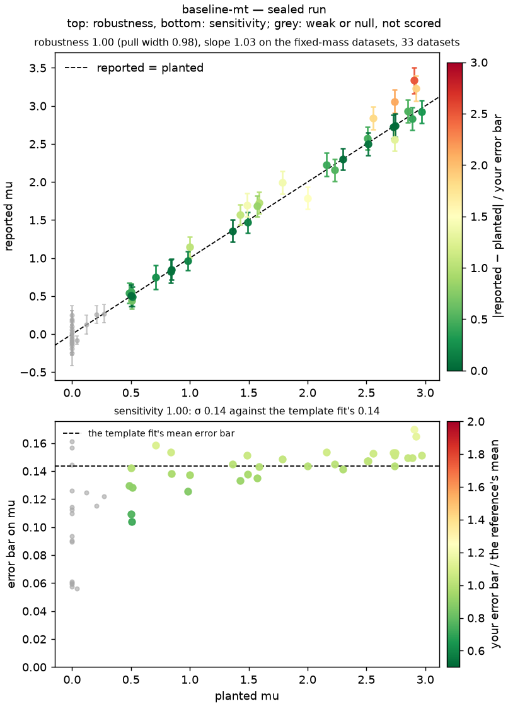
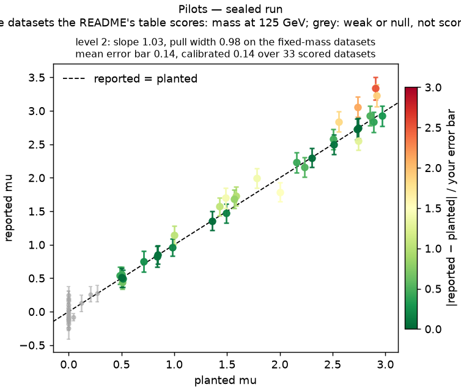
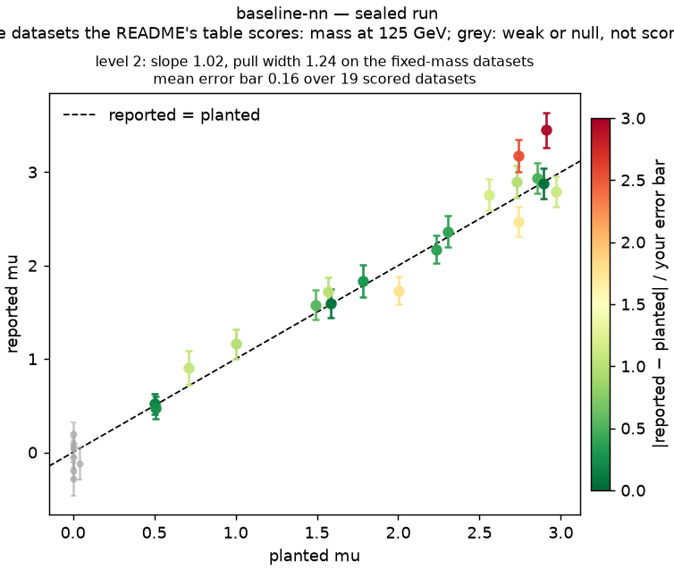

# Hackathon: how much Higgs is in the data?

A Higgs boson decaying to two W bosons and then two leptons and two neutrinos, on top of the WW continuum, in
simulated 13 TeV data; how much of it there is, is unknown. You build a pipeline on the one public dataset,
with the simulation beside it to train on; the organisers run it, unchanged, on sealed datasets with hidden
truths and score whether your signal strength follows the truth with honest error bars.
The pitch: [the slides](https://andrzejnovak.github.io/talks/2026-10-13-hsf-india/index.html?profile=hack).
Everything else, the big picture for non-physicists, the three levels, the loop with the agent, where the
classifier goes, the physics in pictures, debugging, what gets scored, the rules: [`GUIDE.md`](GUIDE.md). The task itself: [`PROMPT.md`](PROMPT.md),
[`DATASET.md`](DATASET.md), [`EVAL_CONTRACT.md`](EVAL_CONTRACT.md).

## Setup

Anywhere with git and Python 3 (numpy and scipy, and the CPU build of PyTorch for a network evaluated with torch:
`pip install numpy scipy matplotlib scikit-learn` and `pip install torch --index-url https://download.pytorch.org/whl/cpu` if missing).
The data is simulated and all of it is in this repository.

```bash
git clone https://github.com/andrzejnovak/hsf-india-hww.git && cd hsf-india-hww
python3 -m sbh check --task hww --submission examples/stub_submission --dataset datasets/public/seed_000 --determinism
bash new_team.sh <team-name>        # -> ~/hack-<team-name>: the task files, the public dataset, submission/ with the stub
```

The second line must end with `determinism (second clean run): PASS`. Your pipeline is `~/hack-<team-name>/submission/`:
a `run.sh <dataset_dir> <output_dir>` that writes `<output_dir>/RESULT.json`, Python 3 with numpy, scipy and torch (CPU, for
inference) at run time.
`examples/template_fit/` is a working start (a fit of the transverse and dilepton masses for the Higgs mass, the
signal strength and the background rate; the leaderboard's `baseline-mt`); `examples/tutorial_nn/` plugs the ML
tutorial's network into the same fit (`baseline-nn`), `examples/nn_fit/` does the same with better features, and
`examples/torch_nn/` trains that network with PyTorch and evaluates it either way, with numpy from `model.json` or with torch
from the state_dict as JSON (`fit_torch.py`).
The self-check with `--submission ~/hack-<team-name>/submission` tells you whether yours runs.

## Submit

```bash
cd ~/hack-<team-name> && git add -A && git commit -m "our submission" && git push   # to a public GitHub repository of yours
cd ~/hsf-india-hww && bash submit.sh <team-name> <git url>                         # the self-check, is it pushed, then one line
```

Post that line, `<team-name>: <git url> @ <commit>`, as a comment on
[issue 1](https://github.com/andrzejnovak/hsf-india-hww/issues/1) (`submit.sh` posts it for you when `gh` is
logged in; the team name is letters, digits, `-` and `_` only, no spaces, and a comment without a line in that
form gets a reply saying so instead of a leaderboard row). Every comment starts the sealed run: your commit on
datasets nobody has seen, and the table below a few minutes later. Submit as often as you like; the last comment
per team before the deadline is the one that counts.
Pushing from a Binder session needs a GitHub token as the password (github.com → Settings → Developer settings →
Personal access tokens); from your laptop it is your usual push.

## Leaderboard

<!-- leaderboard -->
_Sealed run of 2026-10-15 09:19 UTC: every submission on the [issue](https://github.com/andrzejnovak/hsf-india-hww/issues/1) at its last comment, on 51 sealed datasets, the Higgs mass at 125 GeV in all of them and μ and the background rate planted anew in each._

| # | team          | score | precision | honesty | typical miss μ | σ μ   | pull width μ | submitted                                         |
|---|---------------|-------|-----------|---------|----------------|-------|--------------|---------------------------------------------------|
| 1 | Horizon       | 111   | 1.26      | 0.88    | 0.119          | 0.125 | 0.88         | 458fcb0 (2026-10-15T09:05:05Z by AnushSingla)     |
| 2 | thursday-demo | 110   | 1.23      | 0.90    | 0.122          | 0.130 | 0.90         | a71c823 (2026-10-15T04:53:09Z by andrzejnovak)    |
| 3 | Hack-404      | 109   | 1.24      | 0.88    | 0.121          | 0.129 | 0.88         | 0909838 (2026-10-15T07:18:42Z by shaurya-cd)      |
| 4 | team_x        | 103   | 1.04      | 0.99    | 0.144          | 0.138 | 1.01         | d1f83a7 (2026-10-15T09:07:43Z by gauriaggarwal31) |
| 5 | baseline-mt   | 98    | 1.00      | 0.98    | 0.150          | 0.144 | 0.98         | 52ad132 (2026-10-14T08:25:55Z by andrzejnovak)    |
| 6 | Pilots        | 98    | 1.00      | 0.98    | 0.150          | 0.144 | 0.98         | 69e717a (2026-10-15T08:29:02Z by ishandhull2953)  |
| 7 | baseline-nn   | 78    | 0.84      | 0.94    | 0.179          | 0.154 | 1.07         | c549c28 (2026-10-14T08:26:00Z by andrzejnovak)    |

<details>
<summary><b>Recovery plots</b>, per team: honesty on top, each dataset coloured by its pull; precision below, each miss against the template fit's typical miss</summary>

**Horizon** (score 111)



**thursday-demo** (score 110)



**Hack-404** (score 109)



**team_x** (score 103)



**baseline-mt** (score 98)



**Pilots** (score 98)



**baseline-nn** (score 78)



</details>
<!-- /leaderboard -->

### Reading the table

Every team's last submitted commit, on the same sealed datasets each run. Each dataset has its own planted
signal strength μ and background rate, and the Higgs mass at 125 GeV: a measurement of μ at a known mass. The
mass you report (optional in RESULT.json) is for the record, not scored.

- **score** = 100 × **precision** × **honesty**, the order of the table.
- **precision**: how close you land. Your miss on a dataset is reported μ − planted μ, and your **typical miss**
  is its root-mean-square over the scored datasets. Precision is the template fit's typical miss over yours:
  1.20 means you land 20 % closer. A bias or a wrong slope makes you miss by more, so it costs here.
- **honesty**: whether your error bars (**σ μ**) match your misses. The **pull width** is the spread of
  miss / σ, and is 1 when they match. Honesty is the pull width or its inverse, whichever is below 1: error bars
  20 % too small or 20 % too big both give about 0.8.
- The template fit, `baseline-mt`, has precision 1.00 by definition, so its score is 100 × its honesty.
- The table is each team's latest submission; when a newer one replaces it, it moves to the collapsed table under
  it with the score it had. Team names link to the repository, hashes to the code of that commit.

Each team's plot is folded under the table: honesty on top, each dataset coloured by its pull, and precision
below, each miss against the template fit's typical miss. Yours, on datasets you make:
`python3 make_suite.py suites/mine --n 10 --seed 7`, then
`python3 score_suite.py ~/hack-<team>/submission suites/mine --plot-main mu.png`. The sealed plots show the
planted values: for seeing where your score is lost, not for fitting a correction to (a hard-coded answer,
against the rules). The three levels of the [GUIDE](GUIDE.md) are milestones for when you present, not columns here.
