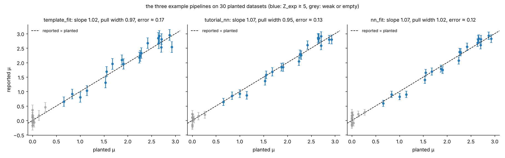
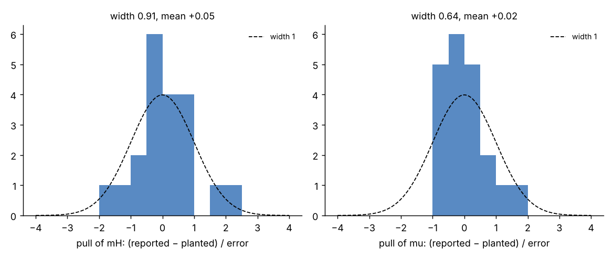

# Hackathon: how much Higgs is in the data?

A Higgs boson decaying to two W bosons and then two leptons and two neutrinos, on top of the WW continuum, in
simulated 13 TeV data; how much of it there is, is unknown. You build a pipeline on the one public dataset,
with the simulation beside it to train on; the organisers run it, unchanged, on sealed datasets with hidden
truths and score whether your signal strength follows the truth with honest error bars.
The pitch: [the slides](https://andrzejnovak.github.io/talks/2026-10-13-hsf-india/index.html?profile=hack).
Everything else, the big picture for non-physicists, the three levels, the loop with the agent, where the
classifier goes, the physics in pictures, debugging, what gets scored, the rules: [`GUIDE.md`](GUIDE.md). The task itself: [`PROMPT.md`](PROMPT.md),
[`DATASET.md`](DATASET.md), [`EVAL_CONTRACT.md`](EVAL_CONTRACT.md).

## Setup

Anywhere with git and Python 3 (numpy and scipy; `pip install numpy scipy matplotlib scikit-learn` if missing).
The data is simulated and all of it is in this repository.

```bash
git clone https://github.com/andrzejnovak/hsf-india-hww.git && cd hsf-india-hww
python3 -m sbh check --task hww --submission examples/stub_submission --dataset datasets/public/seed_000 --determinism
bash new_team.sh <team-name>        # -> ~/hack-<team-name>: the task files, the public dataset, submission/ with the stub
```

The second line must end with `determinism (second clean run): PASS`. Your pipeline is `~/hack-<team-name>/submission/`:
a `run.sh <dataset_dir> <output_dir>` that writes `<output_dir>/RESULT.json`, Python 3 with numpy and scipy only.
`examples/template_fit/` is a working start (a fit of the transverse and dilepton masses for the Higgs mass, the
signal strength and the background rate; the leaderboard's `baseline-mt`); `examples/tutorial_nn/` plugs the ML
tutorial's network into the same fit (`baseline-nn`), `examples/nn_fit/` does the same with better features, and
`examples/torch_nn/` trains that network with PyTorch instead (the pipeline stays numpy: the weights travel as JSON).
The self-check with `--submission ~/hack-<team-name>/submission` tells you whether yours runs.

## Submit

```bash
cd ~/hack-<team-name> && git add -A && git commit -m "our submission" && git push   # to a public GitHub repository of yours
cd ~/hsf-india-hww && bash submit.sh <team-name> <git url>                         # the self-check, is it pushed, then one line
```

Post that line, `<team-name>: <git url> @ <commit>`, as a comment on
[issue 1](https://github.com/andrzejnovak/hsf-india-hww/issues/1) (`submit.sh` posts it for you when `gh` is
logged in; the team name is letters, digits, `-` and `_` only, no spaces, and a comment without a line in that
form gets a reply saying so instead of a leaderboard row). Every comment starts the sealed run: your commit on
datasets nobody has seen, and the table below a few minutes later. Submit as often as you like; the last comment
per team before the deadline is the one that counts.
Pushing from a Binder session needs a GitHub token as the password (github.com → Settings → Developer settings →
Personal access tokens); from your laptop it is your usual push.

## Leaderboard

<!-- leaderboard -->
_Sealed run of 2026-10-15 05:58 UTC: 21 datasets nobody has seen, every submission on the [issue](https://github.com/andrzejnovak/hsf-india-hww/issues/1) at its last comment. Recovery plots follow after the deadline. A submission gets at most 40 minutes per run; the datasets left when they run out count as not run._

| # | team          | level μ | level mass | slope μ | pull width μ | slope mass | pull width mass | false disc. | self-check | submitted                                      |
|---|---------------|---------|------------|---------|--------------|------------|-----------------|-------------|------------|------------------------------------------------|
| 1 | thursday-demo | 2       | 2          | 1.06    | 1.14         | 0.97       | 1.21            | 0/4         | PASS       | a71c823 (2026-10-15T04:53:09Z by andrzejnovak) |
| 2 | baseline-nn   | 2       | 2          | 1.02    | 1.37         | 1.01       | 1.46            | 0/4         | PASS       | c549c28 (2026-10-14T08:26:00Z by andrzejnovak) |
| 3 | Horizon       | 2       | 1          | 1.03    | 1.34         | 0.97       | 1.57            | 0/4         | PASS       | d8bc180 (2026-10-15T04:50:58Z by AnushSingla)  |
| 4 | baseline-mt   | 2       | 1          | 1.03    | 1.34         | 0.97       | 1.57            | 0/4         | PASS       | 52ad132 (2026-10-14T08:25:55Z by andrzejnovak) |
<!-- /leaderboard -->

### Reading the tables

One row per team, its last submitted commit, run on the same sealed datasets every time (a fixed suite, so runs
are comparable). Each dataset has its own planted signal strength μ and background rate; on half of them the
Higgs mass stays at 125 GeV (within 2 GeV), on the other half it is anywhere between 100 and 150 GeV. The table
scores μ on the fixed-mass datasets alone: whether the μ you report follows the planted μ, with error bars that
mean what they say; the mass is not scored there, so a wrong mass cannot drag μ along. Folded under it, the
table with the mass: μ and the mass, each by the same rule, on every dataset, where the two have to move
together. The two plots below show what is measured, for the three example pipelines on 30 datasets of their
own (`make_plots.py`); yours look the same with `score_suite.py`, see the end.

- **level**, the score. **0**, no measurement: the self-check fails, fewer than 90 % of the datasets run, or
  the slope is below 0.8 (the stub reports a constant: slope 0). **1**, follows the truth: slope ≥ 0.8. **2**,
  and honest: pull width within [0.5, 1.5] and no discovery claimed on a dataset without a Higgs. **3** is
  judged when you present: how the agent got there. Rows are ordered by level, then by how close the slope is
  to 1 and the pull width to 1.
- **slope**: a line fitted through reported against planted (the recovery plot below). 1 means your
  measurement moves one-for-one with the truth; 0 that you report the same value whatever was planted.
- **pull width**: the spread of (reported − planted) / your error bar across the datasets (the pulls plot
  below). 1 means your error bars are honest; above 1.5 they are too small, below 0.5 too large, and both fail
  level 2.
- **false disc.**: datasets without a Higgs on which you claimed a discovery, out of all such datasets; any
  fails level 2.
- **self-check**: hygiene, the contract and determinism on the public dataset, the check `submit.sh` runs;
  FAIL is level 0.
- **submitted**: the commit that ran, and when and by whom it was posted.
- **With the mass**, the folded table: **level μ** by the rule above on every dataset, and **level mass** the
  same rule for the optional `mH` (0 when it is not reported on every dataset); ordered by level μ, then level
  mass, then the distance.





Your own plots and both tables' numbers, on datasets you make (the sealed ones are drawn from the same priors,
with a seed you don't have; `make_suite.py` plants the same mix of fixed and moving masses):

```bash
python3 make_suite.py suites/mine --n 10 --seed 7
python3 score_suite.py ~/hack-<team>/submission suites/mine --plot recovery.png
```

The sealed run's per-team recovery plots show the planted values of the sealed datasets, so they go up here
after the deadline.
